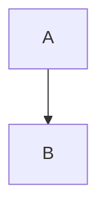

# Features

> [!NOTE]
> Alert note body.

> [!WARNING]
> Alert warning body.

Emoji :rocket: :tada:


- [x] done task
- [ ] open task

| Name | Value |
| :--- | ---: |
| alpha | 1 |
| beta | 22 |

<details>
<summary>More</summary>

Hidden body text.

</details>

```ts
const x: number = 1;
```

$$ e^{i\pi} + 1 = 0 $$


